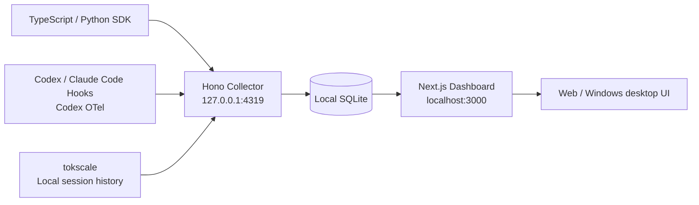

<p align="center">
  
</p>

<h1 align="center">Agent-Trace</h1>

<p align="center">Local-first runtime observability, usage analysis, and diagnostics for AI agents.</p>

<p align="center">
  <a href="README.md">中文</a> ·
  <a href="docs/en/README.md">Documentation</a> ·
  <a href="CHANGELOG.md">Changelog</a> ·
  <a href="CONTRIBUTING.md">Contributing</a>
</p>

Agent-Trace collects model calls, tool execution, tokens, API-equivalent cost, latency, errors, and local session history into SQLite. Its web and Windows desktop interfaces turn that data into searchable, comparable, and diagnosable run traces. Core collection, storage, and visualization do not require a hosted backend.

## Highlights

- TypeScript SDK for explicit Run, LLM, and tool instrumentation.
- Python SDK with nested steps, sync/async decorators, and OpenAI/LangChain adapters.
- Global Codex and Claude Code Hooks for lifecycle and tool metadata.
- Codex OTLP/HTTP JSON ingestion for model and official token telemetry.
- Local `tokscale` scanning for multi-client sessions, tokens, and cost.
- Run analysis with event filters, timelines, parent-child trace trees, failure inspection, retries, slow steps, and token hotspots.
- Token Trace views for daily, weekly, and monthly activity, trends, model usage, and client distribution.
- Quality and cost governance through Run comparison, project analytics, budgets, evaluation datasets, and weighted scores.
- Safe replay with a built-in mock worker for input overrides, simulated output, errors, latency, and timeouts—without executing user code or real tools.
- Local governance with Run projects/tags, retention maintenance, tombstone recovery, and configurable pre-storage field redaction.
- Local Hono collector, bilingual Next.js dashboard, and Windows Electron packaging.

## Data flow



## Requirements

- Node.js `>=22.12.0`; `.nvmrc` selects Node.js 22.
- pnpm `>=11.0.7 <12`; `packageManager` and CI pin 11.0.7.
- Python `>=3.10` when using the Python SDK.
- Windows x64 is required to build the desktop installer.

## Quick start

```bash
pnpm install --frozen-lockfile
pnpm build
node packages/cli/dist/index.js dev
```

After startup, open the interface that matches your task:

| Area | URL | Purpose |
| --- | --- | --- |
| Runs | <http://localhost:3000/runs> | Search, filter, compare, and diagnose agent runs |
| Token Trace | <http://localhost:3000/token-trace> | Explore token trends, activity calendars, and model usage |
| Analytics | <http://localhost:3000/analytics> | Analyze quality and cost by project, environment, model, or source |
| Evaluations | <http://localhost:3000/evaluations> | Manage evaluation datasets, cases, and weighted scores |
| Safe replay | <http://localhost:3000/sandbox> | Replay a Run with the fixed mock worker |
| Maintenance | <http://localhost:3000/maintenance> | Clean, restore, compact, and configure field redaction |

The collector listens on <http://127.0.0.1:4319> by default.

Generate a sample Run in another terminal:

```bash
pnpm --filter simple-agent dev
```

> [!TIP]
> To avoid scanning local history on first start, use
> `node packages/cli/dist/index.js dev --usage-scan=false`.

## Four data sources

### TypeScript SDK

```ts
import { startRun } from "@agent-trace/sdk";

const run = startRun({
  name: "research-agent",
  input: { task: "Research MCP ecosystem" }
});

try {
  const result = await run.traceTool(
    "web_search",
    { query: "MCP ecosystem" },
    () => webSearch("MCP ecosystem")
  );
  await run.end(result);
} catch (error) {
  await run.fail(error);
  throw error;
}
```

Delivery defaults to `http://localhost:4319` with a 1000 ms timeout. Tracing failures do not change the wrapped function's result or exception semantics.

### Python SDK

Install it from the source workspace:

```bash
pip install -e packages/sdk-python
```

```python
from agent_trace import AgentTraceClient
from agent_trace.integrations.openai import instrument_openai

client = AgentTraceClient()
with client.start_run("research-agent", metadata={"project": "demo"}) as run:
    with run.trace_step("retrieval", "load-documents"):
        documents = load_documents()
    openai_client = instrument_openai(openai_client, run)
```

The Python SDK supports nested steps, sync/async decorators, an OpenAI wrapper, and a LangChain callback. It uses the same bounded, fail-open delivery behavior.

### Codex / Claude Code Hooks

```bash
node packages/cli/dist/index.js install codex
node packages/cli/dist/index.js install claude-code
```

The installer only manages Agent-Trace-marked entries and creates a timestamped backup before changing configuration.

### Local usage and sessions

```bash
node packages/cli/dist/index.js usage --once
node packages/cli/dist/index.js usage clients --home <path>
```

For sensitive projects, set `AGENT_TRACE_HISTORY_CONTENT=metadata` before the first scan to avoid storing prompt previews.

## Workspace

| Path | Responsibility |
| --- | --- |
| `apps/server` | Hono collector, SQLite, integrations, and read models |
| `apps/web` | Next.js dashboard |
| `apps/desktop` | Electron main process and Windows packaging |
| `packages/schema` | Shared Zod contracts and TypeScript types |
| `packages/sdk-js` | JavaScript/TypeScript tracing SDK |
| `packages/sdk-python` | Python tracing SDK and framework adapters |
| `packages/cli` | Development orchestration, Hooks, and usage scanning |
| `examples` | SDK and Hook smoke examples |

## Verification

```bash
pnpm verify
```

This runs build, test, type checking, lint, and documentation consistency checks.

## Data, privacy, and cost

> [!WARNING]
> The collector has no authentication and must remain on a loopback interface. Do not expose it directly to an untrusted network.

- Data is stored in local SQLite by default.
- The SDK stores caller-provided input/output and does not redact it automatically.
- Hooks use metadata redaction, but shell commands may still contain sensitive arguments.
- Local history may store cleaned prompt previews unless metadata-only mode is selected.
- All displayed costs are API-equivalent estimates, not subscription invoices.

Read the [privacy and security guide](docs/en/privacy-security.md) before processing sensitive data.

## Documentation

- [English documentation index](docs/en/README.md)
- [User guide](docs/en/user-guide.md)
- [Collector API](docs/en/api-reference.md)
- [Deployment and operations](docs/en/deployment-operations.md)
- [Privacy and security](docs/en/privacy-security.md)
- [System architecture (Chinese)](docs/architecture.md)
- [Domain glossary](CONTEXT.md)
- [Architecture decision records](docs/adr/README.md)
